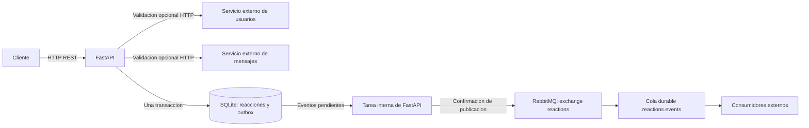
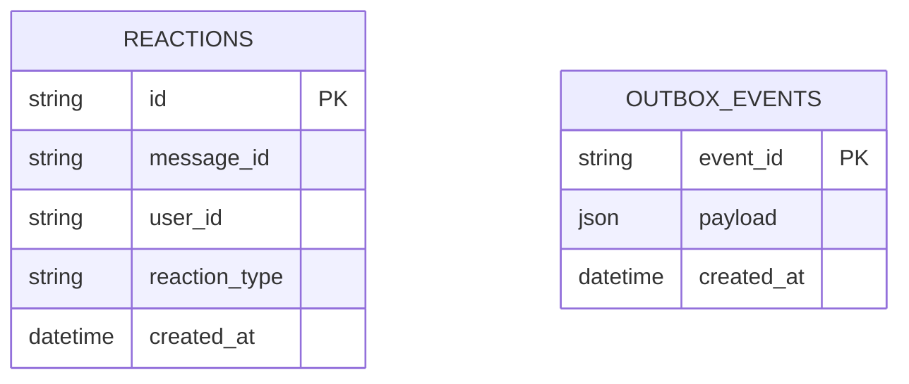

# Arquitectura del servicio de reacciones

Version actual: ver [VERSION](../VERSION). Hay una unica aplicacion FastAPI.
RabbitMQ es infraestructura de mensajeria y el despachador de eventos es una
tarea del mismo proceso de la API.

## Datos persistentes

La combinacion `(message_id, user_id, reaction_type)` es unica. `payload` guarda
el evento completo y su identificador estable. No hay una clave foranea entre
las tablas: el evento de eliminacion debe sobrevivir al borrado de la reaccion.
El DDL generado esta en [schema.sql](schema.sql).

## Flujo de escritura y fallos

1. Validar los datos, el mensaje, el usuario y la ausencia de duplicados.
2. Si `EVENTS_REQUIRED=true`, comprobar RabbitMQ antes de modificar datos.
3. Guardar o eliminar la reaccion y agregar su evento en una misma transaccion.
4. Confirmar la transaccion y devolver 201 o 204.
5. El despachador publica el evento, espera confirmacion y elimina el pendiente.

Si falla la transaccion, se revierten tanto la reaccion como el evento. Si falla
RabbitMQ despues de confirmar, el evento permanece en SQLite para otro intento.
Un reinicio conserva los pendientes siempre que se conserve el volumen de datos.

La entrega es al menos una vez. Si el broker acepta un evento y el proceso cae
antes de borrar el pendiente, se puede repetir la publicacion con el mismo
`event_id`. Cada consumidor debe deduplicar por ese identificador.

## Salud

`GET /health` comprueba la base con un limite de tiempo. Devuelve 503 si falla la
base o si RabbitMQ es obligatorio y esta desconectado. Si el broker es opcional,
una desconexion o eventos pendientes se indican como `status: degraded` con 200.
La consulta informa la conectividad conocida; no valida los servicios externos.
